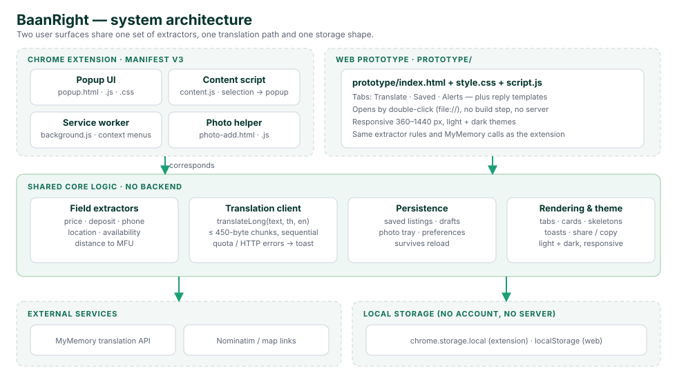

# BaanRight — Final Report (M3)

**Team:** 16RideRight · Group 16 · Intro2SE 15031001, Semester 1/2569
**Product:** BaanRight — Thai housing-listing translator for international students at Mae Fah Luang University (MFU)
**Surfaces:** Chrome extension (Manifest V3) + web prototype (`prototype/index.html`)

---

## 1. The problem

MFU students who do not read Thai lose most of the rental market. Landlords post
in Thai on Facebook groups: rent, deposit, phone number and location are buried in
free text, and the useful details (is the deposit one month or two? is it near the
Fah Thai market? how far is it from campus?) take minutes to decode — per post.
By the time a student has translated three posts by hand, the good room is gone.

BaanRight turns one Thai post into an English listing the student can act on in
a single click: translation, structured facts, distance to campus, and a saved
shortlist to compare.

## 2. Users and key scenarios

- **Primary user:** an MFU international student browsing Facebook housing groups.
- **Scenario A (find):** paste a post → read rent/deposit/phone/location/distance
  in English → call the landlord.
- **Scenario B (compare):** save three listings → search and shortlist them →
  export a CSV to compare side by side.
- **Scenario C (reply):** tick the questions to ask → get a Thai message to paste
  into Messenger.

## 3. What we built

| Surface | What it is | How to open |
|---|---|---|
| Web prototype | The same workflow as a responsive web app (Translate / Saved / Alerts tabs, reply templates) | double-click `prototype/index.html`, or the live link in the README |
| Chrome extension | Popup with the same tabs, plus in-page tools: right-click "Translate with BaanRight", source-link post pulling, photo capture | `chrome://extensions` → Developer mode → **Load unpacked** → repo root |

Both surfaces share the same extractor rules, the same MyMemory translation
client and the same storage shape, so behaviour is identical: what the demo
shows on the web is what the extension does inside Facebook.

## 4. Architecture

No backend and no account: the client holds all logic, the browser holds all
data. Translation is the only network dependency (MyMemory API); map links and
Nominatim are used only when the post contains them. This keeps the product free,
instant and private — nothing is uploaded except the post text being translated.

**Translation path** (`docs/design/sequence-fr-2.svg`): the post is split on line
boundaries into ≤ 450-byte UTF-8 chunks, translated sequentially, then joined.
Extraction always runs on the **original Thai text**, so Thai digits, phone
formats and Thai unit words are read from the source, not from the translation.

**Data** (`docs/design/data-model.svg`): saved listings, photos (as data URLs),
drafts, alerts and the theme are JSON documents in `chrome.storage.local` /
`localStorage`. A saved listing is self-contained and renders offline.

**Use cases** (`docs/design/use-case.svg`): translate, read details, save, search
and shortlist, ask the landlord, attach photos, export, alerts, in-page selection
translate, theme.

## 5. Golden Thread

Requirements and acceptance criteria are in the M2 SRS — [docs/M2-srs.pdf](M2-srs.pdf)
(§3 functional, §4 non-functional, §7 traceability). Every **Must** FR is traced
from the problem to a design element, to the place it is built, and to the
evidence that it works.

| Must FR | Requirement (SRS) | Design element | Where it is built | Test and evidence |
|---|---|---|---|---|
| FR-1 | Input a housing listing | Input form + optional source-link field — `architecture.svg` | Translate tab: textarea, **Load demo**, source link; extension popup paste and source-link pull | Manual: paste, demo post, source-link pull on a real post; empty input is rejected with a message |
| FR-2 | Translate Thai housing listing | Translation client with chunking — `sequence-fr-2.svg` | Translate tab → **Translate listing**; the original Thai stays in the record and in Saved | Demo posts 1–2 translate live (AC-1, AC-2); `translateChunk` tests cover success, quota text, HTTP 429 and other HTTP errors (4 cases) |
| FR-3 | Extract and save key housing information | Field extractors + `SavedListing` — `architecture.svg`, `data-model.svg` | Translate tab → price hero + **Details** grid; **Save listing** → Saved tab (reopen, details compare); a missing field shows “—” instead of a value | `tests/extractors.test` — 11/11: price, deposit formats, phone, location (floor area never mistaken for it), availability, distance; an absent field returns `null`, never an invented value (AC-8); manual save → reload → compare |
| FR-4 | Generate Thai reply to landlord | Reply templates + en→th path — `sequence-fr-2.svg` | Translate tab → **Ask the landlord** → tick questions → **Generate Thai message** → **Copy** | Manual: 5 questions → Thai message generated (AC-1) and copied (AC-2) |
| FR-5 | Translate selected text from a webpage | Content script + context menu — `architecture.svg` | Extension only: select Thai text → right-click → **Translate with BaanRight**; the popup opens pre-filled | Manual on a real Facebook housing post (both ACs) |

### Supporting features (beyond the five M2 FRs)

These were built because the five FRs would be impractical without them. They are
not separate Must FRs in the SRS.

| Feature | Why it exists | Where | Evidence |
|---|---|---|---|
| Distance from MFU | SRS §1.1: compare locations relative to campus | Translate **Distance** row; Saved card | `tests/extractors.test`: map link + km/min (incl. decimals), Fah Thai landmark, explicit “not stated” |
| Saved search + ★ shortlist | FR-3 AC-7 “compare the saved options” needs filtering | Saved tab: search field, **★ Only** | Manual: 3 listings, query `ซอย`, star, remove |
| Photos on a listing | A housing decision needs pictures | Photo tray (**+ Add**, paste, drag & drop) → Saved; download | Manual: duplicates rejected, ≤1000 px downscale, saved and re-downloaded |
| CSV export | Compare off-device | Saved tab → **Export CSV** | Manual: 11 columns, rent as `6000 THB/month` |
| Area + budget alerts | Keeps the target area and budget while browsing | Alerts tab | Manual CRUD |
| Theme, drafts, offline shell | Usability on a phone at night; a tab can close mid-post | Header toggle, autosave, `sw.js` | Manual: theme persists; draft restored after reload |
| Screenshot OCR | Explicitly out of scope (SRS §2.1, §6) | Popup says “not in this build” | — |

### Non-functional requirements (SRS §4)

| NFR | Target | Status / how checked |
|---|---|---|
| NFR-1 performance | Translation shown within 10 s | ≈3–4 s per demo post in our development runs; chunking keeps a long post to two requests |
| NFR-2 performance | Extracted fields within 5 s after processing | Extraction is local and synchronous — the whole 11-test run executes in ~76 ms |
| NFR-3 usability | First-time student pastes and starts within 30 s | Not formally timed with an unfamiliar user; the flow is paste → one button. Gap noted in §7 |
| NFR-4 reliability | Error message, never an empty or misleading translation | Offline test per the SRS (“Couldn't translate that: Failed to fetch”); quota-text and HTTP 429 covered by unit tests |
| NFR-5 security / privacy | Saved listings stay in the student's own browser storage | No server, no account; SRS browser-profile test passed (profile A saves → profile B sees nothing) |

## 6. Verification

1. **Automated:** `node --test tests/extractors.test` — **11 tests, 11 pass**
   (0 fail). The suite loads the pure functions out of `popup.js` in a `vm`
   context, so the shipped code is what is tested.
2. **Manual demo script** run on the prototype and the extension: demo post 1
   (rent 6000, deposit 1 month, phone 081-234-5678, 10 min from MFU), demo post 2
   (rent 4500, deposit 2 months, map link), save → reload → search → star →
   export → reply → theme toggle.
3. **Cross-check with the extension:** the same post produces the same fields in
   the popup and the prototype, because both call the same extractor code.
4. **Responsive check:** 360 / 768 / 1440 px widths — no horizontal overflow;
   dark theme contrast sampled on key text/background pairs.

## 7. Limitations and honest gaps

- **Screenshot OCR** is explicitly out of scope in the SRS and not implemented;
  the UI says so rather than silently failing.
- **Translation quality** depends on MyMemory's free tier. There is a fair-use
  quota; on 429 the app shows the free-limit message. No offline translation.
- **Distance** is what the landlord states (minutes), what a map link implies, or
  a landmark approximation — it is not a routed walking distance.
- **No backend:** saved listings live in the browser only. Clearing site data
  clears them; they are not synced between devices.
- **Photo storage** is bounded by the browser; the app downscales and reports when
  the quota is hit.

## 8. What is next

1. OCR for screenshots (once it moves into scope).
2. A real distance calculation (routing API) instead of stated minutes.
3. Optional account + sync for saved listings.
4. Thai-language UI for landlords, so both sides of the conversation are served.

## 9. How to run the demo

1. Open `prototype/index.html` (double-click) — or the live link in the README.
2. Press **Load demo**, then **Translate listing** (or `Ctrl/Cmd + Enter`).
3. Show the price hero, the details grid, and the distance row.
4. **Save listing** → Saved tab → search, star, export CSV.
5. **Ask the landlord** → choose questions → **Generate Thai message** → copy.
6. For the extension: `chrome://extensions` → Developer mode → **Load unpacked**
   → this folder → open a Thai Facebook post → right-click → *Translate with
   BaanRight*.
